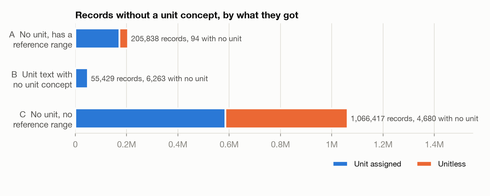

# Unit harmonization of AI-READI EHR measurements

All but 0.2% of numeric measurement records now have a unit (or are marked
unitless) and a value in one canonical unit per test. The results are in
`hive_metastore.ehr_union_clean_metrics.measurement_unit_harmonized`, a full
copy of `ehr_union_clean.measurement` with added columns; the source table is
unchanged.

Of 7,052,556 numeric records, 5,724,872 (81.2%) arrived with a unit concept
and 1,327,684 (18.8%) without one. Now:

| Numeric records | | |
|---|---:|---:|
| In the test's canonical unit | 6,529,079 | 92.6% |
| Unitless (pH, ratios, scores, counts) | 509,251 | 7.2% |
| Unit, but no conversion to the canonical unit | 3,189 | 0.05% |
| No unit | 11,037 | 0.16% |

## Why every test, not the diabetes list

The work started from a list of 29 diabetes-related lab categories
([README.md](README.md), "Target variables"). It grew to every numeric record
because:

- **The list didn't capture its own tests.** It picked tests by matching words
  in OMOP concept names, and the clinical labels it used don't appear in those
  names. 14 of the 29 matched nothing (ALT, AST, total bilirubin, total
  protein, serum albumin, uACR, HDL, LDL, C-peptide, ...). "BUN" matched only
  hCG ("beta su*bun*it"). Other categories swept in unrelated tests: Creatinine
  took every x/creatinine ratio, Globulin took thyroglobulin and SHBG.
- **The missing units were elsewhere.** Of 1.27M numeric records with no unit
  at all, 1.4% were in the listed tests. The bulk is flowsheet data: end-tidal
  CO2, pain scores, tidal volume, heart rate, mean arterial pressure.
- **Conversion was needed across the dataset.** Within the list, the problem was
  mostly mixed units (mEq/L vs mmol/L, IU/L vs U/L), and in the end about 1.01M
  records across all tests needed converting.
- **The method is per test anyway.** A unit is inferred from other records of
  the same test, so once the rules exist they apply to every test.

## What got a unit

Records with no unit concept fell into three groups, handled in order:

- **A. No unit, but a reference range** (205,838). Mostly copied from labeled
  records of the same test, accepted only if the medians agree within a factor
  of 2 (which keeps 98 °F from being called Celsius); an exact reference-range
  match is trusted as is.
- **B. Unit text with no unit concept** (55,429). 223 distinct strings: 138
  map to standard units (nine spellings of the eGFR unit alone), 9 are
  unitless, 18 are junk ("Possible", "PharmD"), and 58 are left unmapped on
  purpose (log viral loads, per-ejaculate counts).
- **C. No unit, no reference range** (1,066,417), almost all flowsheet and
  exam data from one partner. About 100 tests cover 97% of it, mostly with no
  labeled records to copy from, so units come from rules on the test name
  (end-tidal CO2 in mm[Hg], tidal volume in mL, pain scores unitless).

Some tests needed more than a unit:

- **Body temperature** recorded in both °C and °F within one group: split by
  value (under 45 is °C, over 80 is °F).
- **Body weight**: one partner's "lb" records are ounces (median 2,847 = 80.7
  kg), and another records weight in "fluid ounces". Both convert to kg, with
  medians of 80-90 kg across partners.
- **HDL/total cholesterol ratio**: 6,482 values over 1 are total/HDL, stored
  inverted.

## Conversion to a canonical unit

Each test gets one canonical unit, its most common unit unless set by hand
(body weight kg, height cm, temperature °C, HbA1c %). Units convert by fixed
factors (lb to kg, °F to °C, mg/L to mg/dL), and by molar mass or ionic
charge where the analyte is known (mEq/L to mmol/L for sodium, potassium,
chloride and bicarbonate). Mislabeled units were found by comparing converted
medians with those of records already in the canonical unit (seconds coded as
siemens, CEA in "mg/dL" that is ng/mL).

## Not resolved

- **11,037 records with no unit**: Part B strings left unmapped (5,988), codes
  and identifiers stored as numbers (3,794), small tests with no rule yet
  (667), the flagged records below (313), and junk unit text (275).
- **3,189 records with a unit that can't convert**: arbitrary antibody units,
  log viral loads, tests holding two different quantities.
- **Values that don't fit their test**, flagged and not converted (313
  records): for example "total T4" that is free T4, and total lung capacity
  stored under the RV/TLC ratio. Also noted but left as recorded: PT values in
  seconds under the INR concept, RBC counts under reticulocytes.

## Notebooks

Run in order, each in Databricks and as SQL source in this repo:

| | Databricks | Source |
|---|---|---|
| A. No unit, reference range | [notebook](https://adb-7791682337464088.8.azuredatabricks.net/editor/notebooks/2497135705072511?o=7791682337464088) | [A_unit_inference_range_groups.sql](A_unit_inference_range_groups.sql) |
| B. Unit text, no unit concept | [notebook](https://adb-7791682337464088.8.azuredatabricks.net/editor/notebooks/2497135705072510?o=7791682337464088) | [B_unit_inference_with_source_value_but_no_unit_concept.sql](B_unit_inference_with_source_value_but_no_unit_concept.sql) |
| C. No unit, no reference range | [notebook](https://adb-7791682337464088.8.azuredatabricks.net/editor/notebooks/2497135705072512?o=7791682337464088) | [C_unit_inference_no_unit_no_range.sql](C_unit_inference_no_unit_no_range.sql) |
| D. Conversion to canonical units | [notebook](https://adb-7791682337464088.8.azuredatabricks.net/editor/notebooks/2497135705072513?o=7791682337464088) | [D_unit_conversion.sql](D_unit_conversion.sql) |
| E. Checks and review of the run | [notebook](https://adb-7791682337464088.8.azuredatabricks.net/editor/notebooks/2497135705072514?o=7791682337464088) | [E_review_outputs.sql](E_review_outputs.sql) |

Every rule is a table in `ehr_union_clean_metrics` and every record carries
`unit_inference_method`, so any assigned unit can be traced to the rule that
set it. Notebook E holds the checks (all pass) and the reviews behind the
numbers above.
